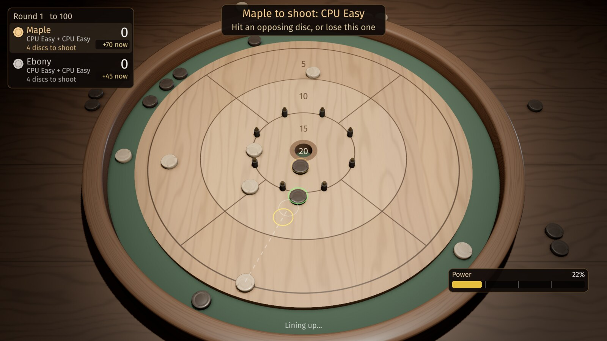
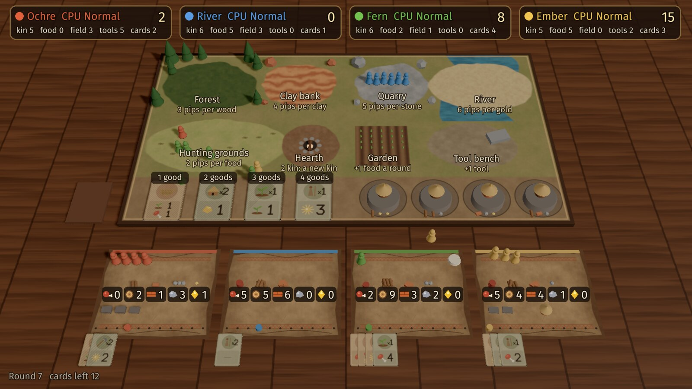
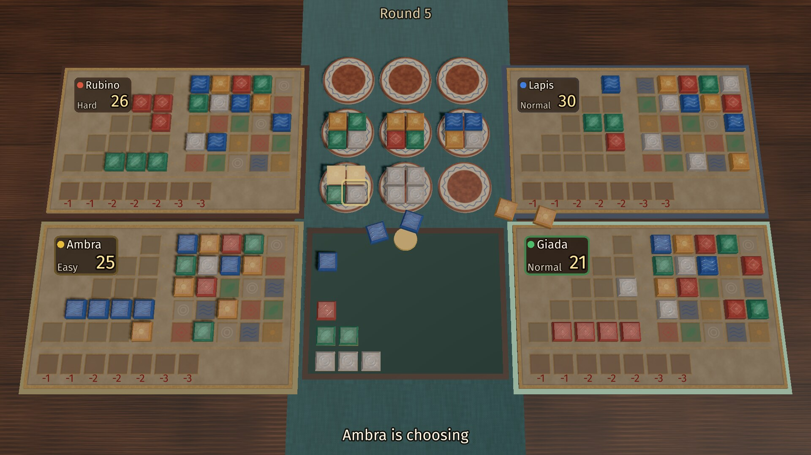
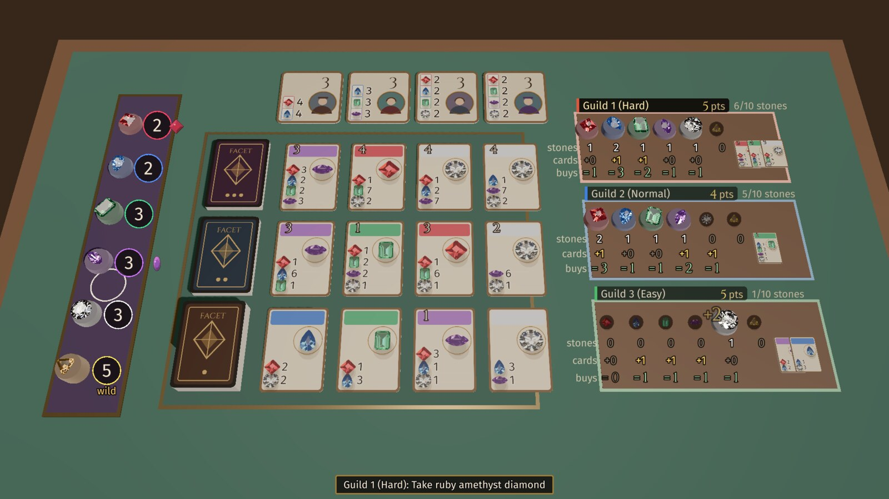
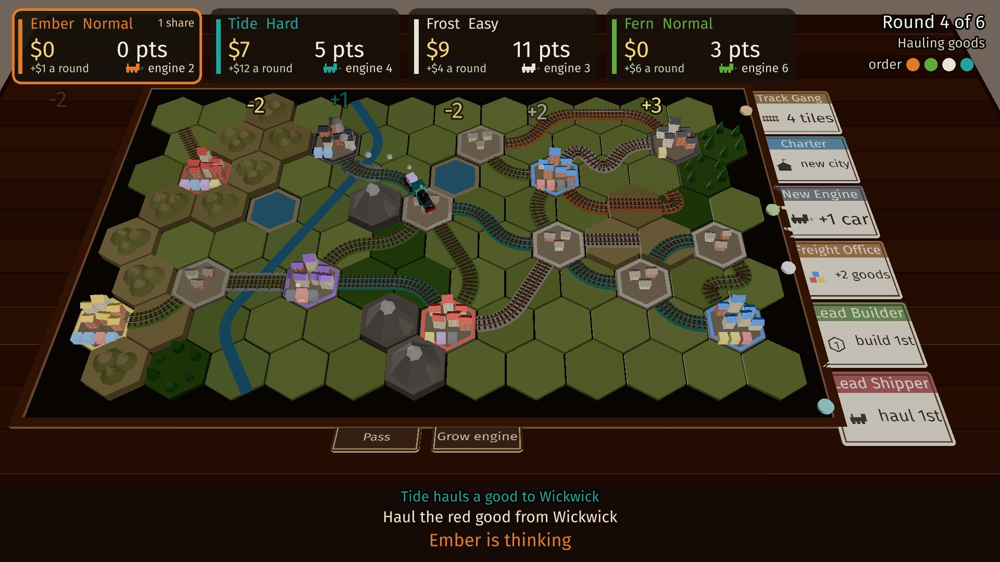
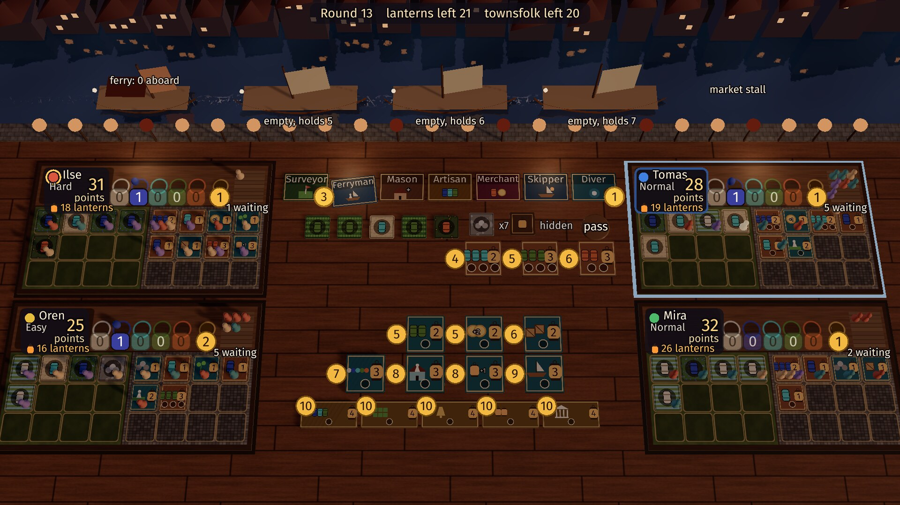
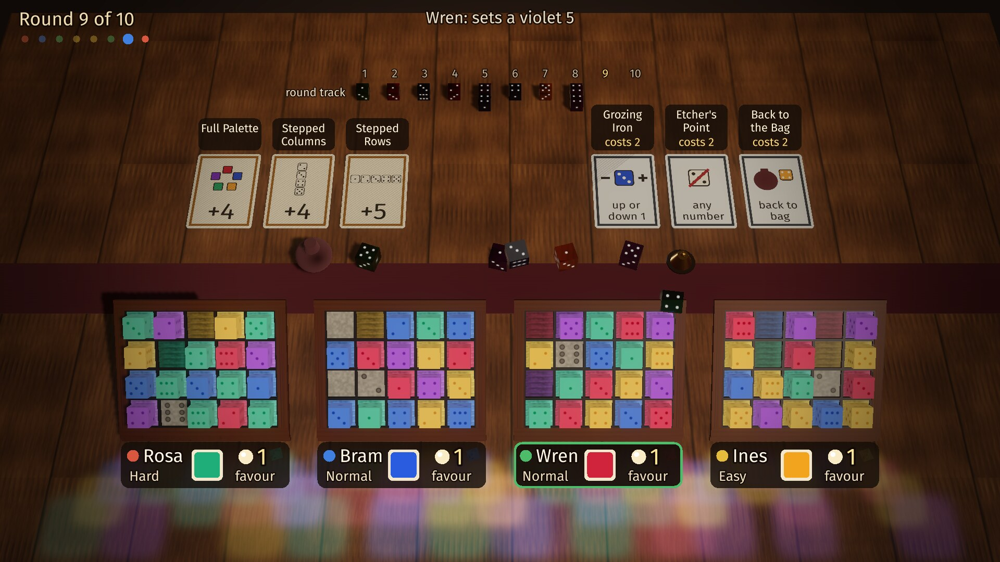
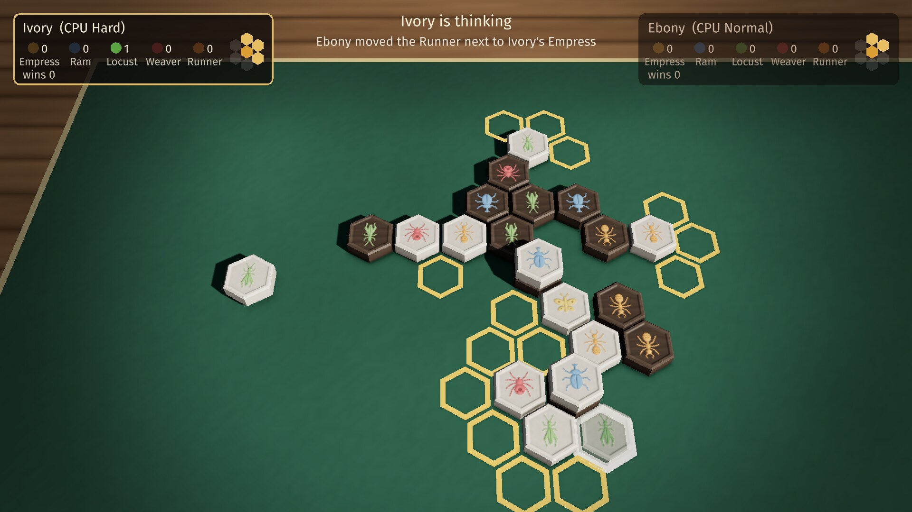
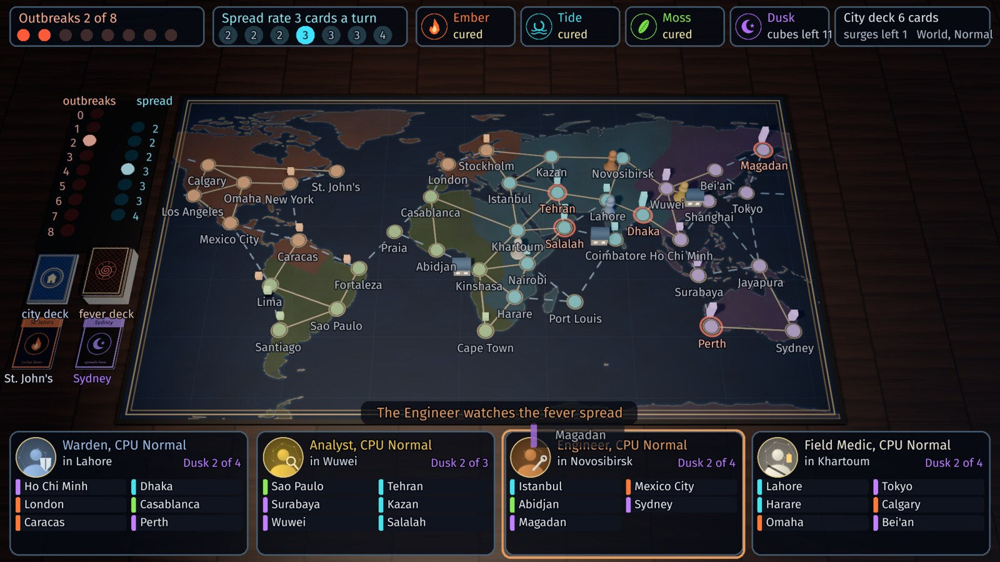

# cartwheel-boardgames

[](https://github.com/monteslu/cartwheel-boardgames/actions/workflows/ci.yml)

Ten tabletop games for one shared screen, built with
[cartwheel-engine](https://github.com/monteslu/cartwheel-engine). Every game:

- plays on one screen with up to four people, even when they share a single gamepad;
- plays with a gamepad alone, and with touch or a mouse;
- has computer opponents at Easy, Normal and Hard, so you can always play solo;
- keeps nothing hidden that a shared screen would give away.

Each game is a [wasmcart](https://github.com/wasmcart/wasmcart) cart (`.wasc`): one file that runs in a browser,
in Node, in a native player and in RetroArch, on GL or WebGPU.

## Play

Download the `.wasc` files from the [latest release](https://github.com/monteslu/cartwheel-boardgames/releases/latest)
and open one in any wasmcart player.

## The games

| Game | Players | In one line | Status |
|---|---|---|---|
| [Crokinole](#crokinole) | 1-4 | flick wooden discs toward the centre of a round board | playable |
| [First Hearth](#first-hearth) | 1-4 | send your clan out to gather, build and grow a stone-age village | playable |
| [Smalti](#smalti) | 1-4 | draft coloured glass and set it into a Venetian mosaic | playable |
| [Facet](#facet) | 1-4 | collect gems, buy cards that make the next ones cheaper, win patrons | playable |
| [Smokestack](#smokestack) | 1-4 | lay track across a hex valley and haul goods to the cities that want them | playable |
| [Lantern Harbor](#lantern-harbor) | 1-4 | take a job each round and grow a lantern-lit harbour town | playable |
| [Rose Window](#rose-window) | 1-4 | draft glass dice into your own stained-glass window | playable |
| [Kilowatt Country](#kilowatt-country) | 1-4 | bid on power plants, buy fuel and light up real cities on seven maps | playable |
| [Mandible](#mandible) | 1-2 | surround the rival Empress with carved insect pieces | playable |
| [Fever Line](#fever-line) | 1-4 | work together to cure four fevers spreading across a map | playable |

<!-- One section per game, in the table's order. Template:
### <Title>

<2-4 sentences: what you do and how you win, in plain words.>
- **Players:** ... (computer at Easy, Normal or Hard for any empty seat)
- **Folder:** `games/<folder>`
- **Credits:** inspired by <game> (or: a traditional game)
-->

### Crokinole


Flick your discs from the edge of your quarter of the board toward the hole in the middle. If the other side has a
disc on the board you must hit one, or yours comes off. A disc in the hole scores 20 at once; when all discs are
played, discs score 15, 10 or 5 by ring and the higher side scores the difference, to 100.

- **Players:** 2-4 (four as two teams), any mix of people and computer opponents; one person plays a Normal computer opponent
- **Folder:** `games/crokinole`
- **Credits:** a traditional game

### First Hearth


Each round, take turns sending your kin to hunt, to gather wood, clay, stone or gold, to grow the village, to make
tools, or to claim a lore card or a building. Every kin at a gathering place rolls a die and the pips decide the
haul; then every kin must eat. When the cards run out or a building pile is empty, the most points wins.

- **Players:** 2-4, any mix of people and computer opponents; one person plays a Normal computer opponent
- **Folder:** `games/firsthearth`
- **Credits:** inspired by Stone Age

### Smalti


Take every tile of one colour from a tray and stage it on your rows. At the end of a round each full row sets one
tile into your 5x5 mosaic, scoring for the run it joins across and down. Tiles that don't fit break and cost
points. The game ends after the round in which someone completes a mosaic row.

- **Players:** 2-4, any mix of people and computer opponents; one person plays a Normal computer opponent
- **Folder:** `games/smalti`
- **Credits:** inspired by Azul

### Facet



Take three stones of different colours from the tray, or two of one colour from a stack of four or more, and
spend them on commission cards; every card you own is a bonus stone that pays part of each later one. Set a card
aside to buy later and take a wild topaz, and win a patron when your bonuses meet theirs. The first guild to 15
points ends the round, and the most points wins. On your turn the cards you can pay for now glow from beneath,
and back steps out of a pick one stone at a time.

- **Players:** 1-4, any mix of people and computer guilds at Easy, Normal or Hard; one person plays a Normal guild
- **Folder:** `games/facet`
- **Credits:** inspired by Splendor

### Smokestack


Bid for first place, take a job card, then lay track tiles to link towns and cities across hills, forests and a
river. Haul goods over finished links to the city of their colour: every link a good uses pays its owner a point,
and your own links pay you as points or as income. After the last round each finished link adds two points, every $4
left adds one and each share you issued takes one away; the most points wins.

- **Players:** 2-4, any mix of people and computer opponents; one person plays a Normal computer opponent
- **Folder:** `games/smokestack`
- **Credits:** inspired by Steam

### Lantern Harbor


Each round everyone takes one job from an open row, and then every player carries it out: claim plots, staff them
with townsfolk off the ferry, raise workshops and guild houses, make goods, sell them at the stall or load them onto
the boats for lanterns. Goods that cannot be stored spoil after the boats sail. The game ends after the round in
which the lanterns or the townsfolk run out or a town fills; lanterns, building values and staffed grand buildings
score.

- **Players:** 2-4, any mix of people and computer opponents; one person plays a Normal computer opponent
- **Folder:** `games/lanternharbor`
- **Credits:** inspired by Puerto Rico

### Rose Window


Each round coloured glass dice are rolled into a pool and everyone takes two, setting them into their own window
of twenty panes: colours and numbers marked on a pane must match, and dice side by side never share a colour or a
number. Tools paid with favour bend the rules. After ten rounds the shared goal cards, your own colour and your
leftover favour score, and every empty pane costs a point; alone, you try to beat the dice left on the round track.

- **Players:** 1-4, any mix of people and computer opponents; one person alone plays against the round track
- **Folder:** `games/rosewindow`
- **Credits:** inspired by Sagrada

### Kilowatt Country


Bid for power plants at auction, buy coal, oil, garbage or uranium as prices climb, and wire houses into real cities
across a night map, paying for every link from your network by its real distance. Each round your plants burn their
fuel to light your cities and pay you for each one lit. When a company reaches the city goal, the most cities lit that
round wins.

- **Players:** 2-4, any mix of people and computer opponents (Easy, Normal or Hard); one person plays a Normal
  computer opponent; 2 players get three of a map's five regions, 3 get four, 4 get all five
- **Maps:** United States, Eastern States, Great Lakes, France, Iberia, The Balkans, Central Europe: thirty cities
  each (city data from GeoNames, CC BY 4.0; land, borders, lakes and rivers from Natural Earth)
- **Folder:** `games/kilowattcountry`
- **Credits:** inspired by Power Grid

### Mandible


No board: carved hexagonal pieces are placed and moved on an open table, always touching as one group. Surround
the other side's Empress on all six sides to win. Each insect moves its own way: the Empress one step, the Ram
one step and over the top of others, the Locust in a straight jump, the Weaver exactly three steps, the Runner as
far around the group as it likes.

- **Players:** 2, or 1 against the computer
- **Folder:** `games/mandible`
- **Credits:** inspired by Hive

### Fever Line


Four fevers spread across a night map of real cities, and your team of agents races to cure them all. Each turn an
agent takes four actions (travel, treat a city, build a clinic, share a card, cure a fever at a clinic), draws two
cards, and then the fever spreads; a city that gets a fourth cube breaks out into its neighbours. Cure all four to
win together; eight outbreaks, an empty cube supply or an empty deck lose it.

- **Players:** 1-4 working together, every card face up; one person can play two to four agents, and the computer
  plays any agent at Easy, Normal or Hard; Intro, Normal or Heroic setup
- **Maps:** World, North America, Europe, Nordic, British Isles, India, Africa, East Asia, Japan (city data from
  GeoNames, CC BY 4.0; coasts from Natural Earth)
- **Folder:** `games/feverline`
- **Credits:** inspired by Pandemic

## For developers

```sh
scripts/fetch-deps.sh   # the pinned engine SDKs (scripts/deps.lock)
scripts/build.sh        # build/native and build/cart-wgpu/carts/<game>.wasc
```

- [AGENTS.md](AGENTS.md): building, tests, gates and how to add a game.
- [docs/boardkit.md](docs/boardkit.md): the shared board-game kit (turns with undo, computer players, decks, dice,
  cards, cursors, lobby, credits).
- `games/kitdemo`: a tiny two-player card game that uses every part of the kit. It is the template new games copy
  and is not part of the release.

## Licence

MIT (see [LICENSE](LICENSE)). Each game's credits and third-party licences are in `games/<folder>/CREDITS`.
